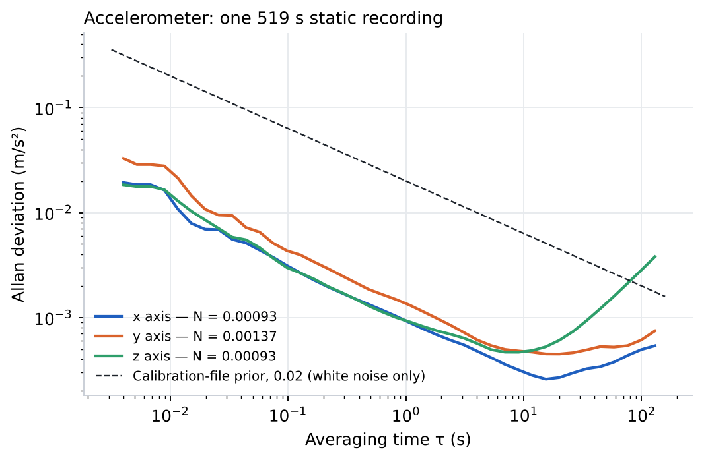
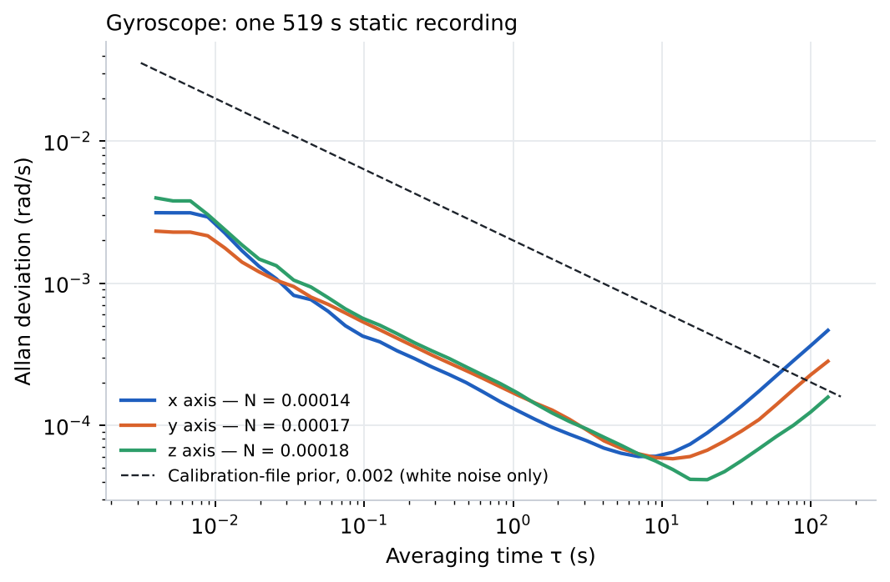
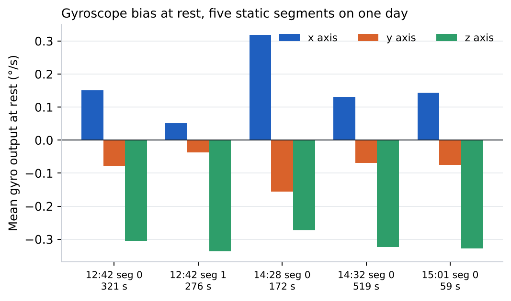
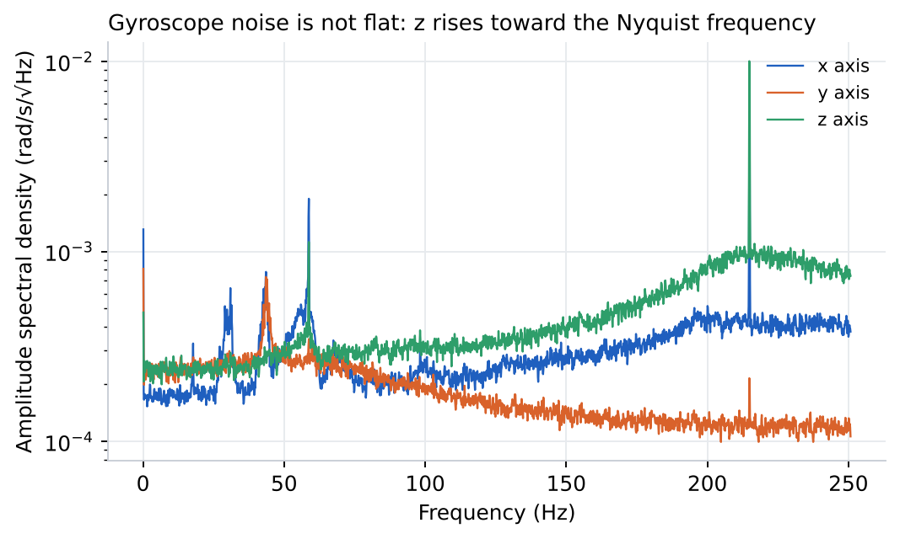

<!-- ODL_QUALITY_V2 -->

# Origin Data Lab · Technical Field Note #14

**ODL Static IMU Allan Deviation**

[](https://github.com/origin-data-lab/imu-noise-bias-static-characterization-stereo-imu-rig) [](https://huggingface.co/datasets/origin-data-lab/imu-noise-bias-static-characterization-stereo-imu-rig) [](https://www.kaggle.com/datasets/origindatalab/odl-static-imu-allan) [](https://origindatalab.io/technical-field-notes/imu-noise-bias-static-characterization-stereo-imu-rig.html)

[English technical note](https://origindatalab.io/technical-field-notes/imu-noise-bias-static-characterization-stereo-imu-rig.html) | [Korean technical note](https://origindatalab.io/ko/technical-field-notes/imu-noise-bias-static-characterization-stereo-imu-rig.html)

---

# ODL Field Note #14 — IMU noise and bias from static recordings
Find still segments inside existing recordings and compute per-axis overlapping Allan deviation, white-noise density, bias instability, bias at rest and spectra.
```bash
pip install numpy pandas matplotlib
cd analysis && PYTHONPATH=. python3 a8_imu_static.py out <file1.imu> [<file2.imu> ...]
PYTHONPATH=. python3 make_figures_14.py
```
Reader for the ZXIMU v6 format: `read_zximu.py` (record layout reverse-engineered; temperature field unconverted). Raw IMU files are not distributed.
Licence: Creative Commons Attribution 4.0 International (CC BY 4.0) for derived data and figures; MIT for code.

## Visual evidence

Figures are taken from the released technical-note package. Interpret with the original methods and limitations.

### Figure 1



*Accelerometer Allan deviation, same segment.*

### Figure 2



*Gyroscope Allan deviation, 519 s static segment, with the white-noise prior from the calibration file.*

### Figure 3



*Mean gyro output at rest per axis for each static segment.*

### Figure 4



*Gyroscope amplitude spectral density on the static segment (Welch, 4096-sample Hann windows).*


---

## Explore Origin Data Lab

[](https://github.com/origin-data-lab/imu-noise-bias-static-characterization-stereo-imu-rig) [](https://huggingface.co/datasets/origin-data-lab/imu-noise-bias-static-characterization-stereo-imu-rig) [](https://www.kaggle.com/datasets/origindatalab/odl-static-imu-allan) [](https://origindatalab.io/technical-field-notes/imu-noise-bias-static-characterization-stereo-imu-rig.html)

[Official Website](https://origindatalab.io/) | [Technical Field Notes](https://origindatalab.io/technical-field-notes/) | [English Note](https://origindatalab.io/technical-field-notes/imu-noise-bias-static-characterization-stereo-imu-rig.html) | [Korean Note](https://origindatalab.io/ko/technical-field-notes/imu-noise-bias-static-characterization-stereo-imu-rig.html)

[GitHub](https://github.com/origin-data-lab/imu-noise-bias-static-characterization-stereo-imu-rig) | [Hugging Face](https://huggingface.co/datasets/origin-data-lab/imu-noise-bias-static-characterization-stereo-imu-rig) | [Kaggle Dataset](https://www.kaggle.com/datasets/origindatalab/odl-static-imu-allan) | [Kaggle Notebook](https://www.kaggle.com/code/origindatalab/odl-static-imu-allan-notebook)
